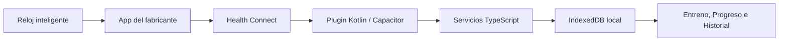

# Integración de salud de Arsen con Health Connect

## Introducción

Arsen era una aplicación móvil de registro de rutinas y sesiones de entrenamiento que funcionaba de forma local. Como ampliación de esa aplicación se incorporó una integración opcional con Android Health Connect para relacionar el entrenamiento registrado en Arsen con datos de salud publicados por un reloj inteligente u otra aplicación compatible.

La función no crea una conexión Bluetooth con el reloj. La cadena real es:



La responsabilidad de cada parte es distinta:

- El reloj obtiene las mediciones.
- La aplicación del fabricante sincroniza el reloj y publica los registros.
- Health Connect funciona como almacén local común y administra permisos.
- Kotlin consulta Health Connect y traduce la respuesta al puente Capacitor.
- React solicita la lectura, transforma el resultado y guarda un resumen junto a la sesión de Arsen.
- La interfaz muestra ese resumen sin enviar los datos a un servidor.

La integración se agregó como una capacidad secundaria: la app base sigue funcionando sin Health Connect, sin smartwatch y sin permisos de salud.

## Metodología

La documentación se construyó siguiendo el recorrido de los datos en la implementación actual:

1. Se identificó la configuración visible en `Ajustes` y los mensajes que explican el funcionamiento al usuario.
2. Se siguió el contrato TypeScript del plugin Capacitor hasta los métodos Kotlin.
3. Se revisó cómo Kotlin consulta `HeartRateRecord`, `OxygenSaturationRecord`, `ActiveCaloriesBurnedRecord` y `StepsRecord`.
4. Se verificó cómo React calcula las ventanas de lectura para el día, la sesión y cada ejercicio.
5. Se comprobó cómo se persiste el resumen en `WorkoutSession.health` y cómo Progreso e Historial lo reutilizan.
6. Se contrastaron las restricciones de la implementación con la documentación oficial de Android Health Connect.

El objetivo no fue describir una integración ideal, sino explicar la funcionalidad que ya existe y sus condiciones reales de uso.

## Desarrollo

### 1. Activación desde Ajustes

La integración aparece en `Ajustes → Salud opcional` y está desactivada por defecto. El asistente muestra tres pasos:

1. **Disponibilidad de Health Connect.** Arsen distingue entre proveedor disponible, proveedor que requiere actualización y proveedor no disponible.
2. **Permisos de lectura de Arsen.** Se solicitan únicamente frecuencia cardiaca, calorías activas, pasos y saturación de oxígeno. El usuario puede concederlos parcialmente.
3. **Aplicación que administra el reloj.** El usuario debe sincronizar primero el reloj en la aplicación correspondiente, por ejemplo Mi Fitness, Samsung Health, Fitbit o Garmin Connect cuando el modelo, la versión y la región lo permitan.

El botón **Activar integración** comprueba la disponibilidad, abre el contrato oficial de permisos y guarda `healthIntegrationEnabled: true` cuando se concede al menos un permiso. Si Health Connect no está instalado o necesita actualizarse, se intenta abrir Google Play; el plugin mantiene un fallback web.

Arsen no afirma que el reloj esté conectado. Health Connect puede estar disponible aunque la aplicación del fabricante todavía no haya publicado datos.

### 2. Lectura nativa en Kotlin

El punto de entrada Android es `MainActivity`, que registra `HealthConnectPlugin` en Capacitor. El plugin expone estas operaciones a React:

| Operación | Función |
|---|---|
| `getAvailability` | Comprueba si Health Connect está disponible. |
| `getPermissions` | Lee los permisos que Arsen tiene actualmente. |
| `requestHealthPermissions` | Abre la pantalla oficial para solicitar permisos. |
| `openHealthConnectAccess` | Abre la gestión de acceso de Arsen en Health Connect. |
| `openHealthConnectInstall` | Abre Google Play o el navegador para instalar Health Connect. |
| `readDayHealth` | Lee el día y, opcionalmente, los rangos de sesión y ejercicio. |

`HealthConnectManager` vuelve a comprobar los permisos antes de cada lectura. Esto permite soportar permisos parciales o permisos revocados sin bloquear las métricas que sí continúan disponibles.

Para cada ventana de tiempo:

- El pulso se lee con `readRecords` y se conservan sus muestras temporales para calcular promedio, máximo y mínimo.
- El oxígeno se lee con `readRecords` y se calcula su promedio.
- Las calorías activas se obtienen con `aggregate`.
- Los pasos se obtienen con `aggregate(COUNT_TOTAL)` porque son un dato acumulativo.
- Las respuestas paginadas se recorren hasta que Health Connect ya no entrega `pageToken`.

El resultado Kotlin se convierte en un objeto JSON compatible con el contrato TypeScript. Las métricas no disponibles se envían como `null`; no se convierten en cero porque cero significaría que la métrica sí fue medida.

### 3. Ventanas de lectura

React no consulta solamente “lo último que haya”. Primero calcula los intervalos exactos que enviará al plugin:

- **Día:** desde la medianoche local de `WorkoutSession.date` hasta la hora de sincronización, sin pasar al día siguiente.
- **Sesión:** con series principales, desde la primera serie registrada hasta la última. En sesiones antiguas puede usar `startedAt`, `completedAt` o `lastExerciseAt` como fallback.
- **Ejercicio:** desde la primera hasta la última serie principal de ese ejercicio. Si solo existe una serie, no se crea una ventana porque no existe una duración real que medir.

Las métricas no se prorratean entre ejercicios. Una lectura diaria representa el día completo; una lectura por ejercicio representa únicamente el intervalo de ese ejercicio.

### 4. Consumo desde React y persistencia

La función `syncWorkoutHealth` realiza este flujo:

1. Verifica que la integración esté activada y que la app se ejecute en Android nativo.
2. Comprueba que Health Connect esté disponible.
3. Busca la sesión y sus ejercicios en Dexie/IndexedDB.
4. Calcula los rangos del día, de la sesión y de los ejercicios.
5. Llama a `healthConnect.readDayHealth(...)`.
6. Une la respuesta nativa con los nombres e identificadores de los ejercicios.
7. Guarda el resumen en `WorkoutSession.health`.

La sincronización se ejecuta al pulsar **Sincronizar salud** en Entreno. `syncAllWorkoutHealth` recorre las sesiones guardadas hasta la fecha actual para recuperar datos históricos que Health Connect todavía conserve. No se sincroniza en segundo plano.

El modelo persistido tiene esta forma conceptual:

```ts
type HealthSummary = {
  syncedAt: string
  day: HealthWindowSummary
  session?: HealthWindowSummary
  exercises?: HealthExerciseSummary[]
  sessionEndSource?: 'completed' | 'last-exercise' | 'sync-time'
}
```

Solo se guarda el resumen necesario para la aplicación. Las muestras crudas permanecen en Health Connect; Arsen no crea una tabla adicional de Dexie ni almacena una copia completa de cada registro.

### 5. Presentación en la aplicación

#### Entreno

Cuando la integración está activa aparece la tarjeta **Salud sincronizada** debajo del calentamiento. Es un panel colapsable con:

- Resumen del día.
- Resumen de la sesión.
- Resumen del ejercicio actual.
- Pulso promedio; en la vista ampliada, máximo y mínimo.
- Calorías activas, pasos y oxígeno.
- Rango horario y duración de la ventana.
- Botón de sincronización manual.

La tarjeta también permite cambiar de vista con botones, pestañas o gesto horizontal. Si no existen registros, muestra **Sin datos publicados todavía** y explica que primero debe sincronizarse la aplicación del reloj con Health Connect.

#### Progreso

El repositorio de salud proyecta los resúmenes guardados a puntos diarios. Progreso muestra:

- Tendencia de pulso promedio, calorías y pasos.
- El día con mayor gasto calórico disponible.
- Estadísticas recientes por ejercicio: fecha, series, duración, pulso y calorías.
- La ventana y los datos del último ejercicio seleccionado.

#### Historial

Historial reutiliza el `health` persistido en la sesión. No vuelve a consultar Health Connect, por lo que puede mostrar el resumen guardado incluso cuando no se está realizando una sincronización nueva.

### 6. Qué ocurre con los datos

Los datos siguen este tratamiento:

1. Se leen únicamente después de una acción explícita del usuario y con permisos concedidos.
2. Se resumen por ventanas de tiempo.
3. Se conservan como números y rangos ISO-8601 en la sesión local.
4. Se muestran dentro de Arsen y se incluyen en los respaldos válidos de la aplicación.
5. No se envían a un backend ni a un servidor de Arsen.

La ausencia de datos no se interpreta como una medición de cero. Por ejemplo, `steps: null` significa que no hubo permiso o que Health Connect no devolvió pasos para esa ventana; no significa que el usuario haya dado cero pasos.

### 7. Limitaciones de Health Connect consideradas

- Health Connect es exclusivo de Android y requiere Android 9/API 28 o superior con Google Play Services.
- En Android 14 o superior forma parte del sistema; en Android 13 o inferior se necesita instalar la aplicación desde Google Play.
- La disponibilidad del proveedor no garantiza que el reloj haya sincronizado datos.
- La aplicación del fabricante puede necesitar abrirse para recibir o publicar los registros.
- Cada fabricante puede publicar métricas con distinta frecuencia y granularidad. La interfaz de Arsen advierte que pueden existir intervalos aproximados de 30 minutos.
- Un permiso concedido no garantiza que exista un registro para la ventana consultada.
- Arsen solicita permisos parciales y sigue mostrando las métricas disponibles; el resto permanece en `null`.
- La lectura histórica está limitada por las reglas de Health Connect. La implementación no solicita el permiso adicional de historial, por lo que no debe prometer acceso ilimitado a datos anteriores a la concesión de permisos.
- Health Connect no se consulta en segundo plano: el usuario debe volver a Entreno y tocar **Sincronizar salud**.
- Arsen no lee directamente el reloj, no escribe registros en Health Connect y no identifica de forma fiable qué aplicación del fabricante publicó cada dato.
- Los perfiles de trabajo de Android no son un escenario compatible para confiar en la API de Health Connect.

Fuentes oficiales consultadas:

- [Disponibilidad de Health Connect](https://developer.android.com/health-and-fitness/health-connect/availability)
- [Inicio y lectura de datos](https://developer.android.com/health-and-fitness/health-connect/get-started)
- [Lectura de datos sin procesar](https://developer.android.com/health-and-fitness/health-connect/read-data)
- [Datos agregados](https://developer.android.com/health-and-fitness/health-connect/aggregate-data)
- [Tipos de datos](https://developer.android.com/health-and-fitness/health-connect/data-types)

## Códigos explicados

Estos son los archivos más importantes para consultar y capturar en una presentación:

| Parte | Archivo | Qué muestra |
|---|---|---|
| Contrato nativo | [`src/domains/health/native.ts`](../src/domains/health/native.ts) | Tipos del puente Capacitor, permisos, rangos y resultados. |
| Ventanas | [`src/domains/health/calculations.ts`](../src/domains/health/calculations.ts) | Cómo se calculan los rangos de día, sesión y ejercicio. |
| Orquestación React | [`src/domains/health/services.ts`](../src/domains/health/services.ts) | Activación, lectura, unión con sesiones y persistencia local. |
| Proyección para Progreso | [`src/domains/health/repository.ts`](../src/domains/health/repository.ts) | Conversión del resumen persistido a puntos diarios y por ejercicio. |
| Configuración | [`src/domains/health/components/HealthSetupWizard.tsx`](../src/domains/health/components/HealthSetupWizard.tsx) | Los tres pasos y las limitaciones que se muestran al usuario. |
| Página Ajustes | [`src/domains/settings/pages/SettingsPage.tsx`](../src/domains/settings/pages/SettingsPage.tsx) | Activación, consulta de permisos y apertura de Health Connect. |
| Tarjeta de Entreno | [`src/domains/health/components/HealthSummaryCard.tsx`](../src/domains/health/components/HealthSummaryCard.tsx) | Carrusel de día, sesión y ejercicio; estados sin datos. |
| Página Entreno | [`src/domains/workout/pages/WorkoutPage.tsx`](../src/domains/workout/pages/WorkoutPage.tsx) | Sincronización manual y entrega del resumen a la tarjeta. |
| Tarjeta de Progreso | [`src/domains/health/components/HealthProgressCard.tsx`](../src/domains/health/components/HealthProgressCard.tsx) | Tendencia diaria y estadísticas por ejercicio. |
| Página Progreso/Historial | [`src/domains/progress/pages/ProgressPage.tsx`](../src/domains/progress/pages/ProgressPage.tsx) | Lectura local del resumen y presentación por ejercicio. |
| Puente Capacitor | [`android/app/src/main/kotlin/com/kumchovy/arsen/codex/health/HealthConnectPlugin.kt`](../android/app/src/main/kotlin/com/kumchovy/arsen/codex/health/HealthConnectPlugin.kt) | Métodos expuestos a JavaScript y validación de rangos. |
| Acceso Health Connect | [`android/app/src/main/kotlin/com/kumchovy/arsen/codex/health/HealthConnectManager.kt`](../android/app/src/main/kotlin/com/kumchovy/arsen/codex/health/HealthConnectManager.kt) | Permisos, lecturas, agregados y paginación. |
| Resumen nativo | [`android/app/src/main/kotlin/com/kumchovy/arsen/codex/health/HealthSummaryCalculator.kt`](../android/app/src/main/kotlin/com/kumchovy/arsen/codex/health/HealthSummaryCalculator.kt) | Promedios, máximos, mínimos y preservación de `null`. |
| Registro del plugin | [`android/app/src/main/java/com/kumchovy/arsen/codex/MainActivity.java`](../android/app/src/main/java/com/kumchovy/arsen/codex/MainActivity.java) | Registro de `HealthConnectPlugin` en la actividad Capacitor. |
| Permisos Android | [`android/app/src/main/AndroidManifest.xml`](../android/app/src/main/AndroidManifest.xml) | Permisos de lectura y pantalla de justificación de privacidad. |
| Compatibilidad de respaldos | [`src/shared/validation/arsenImportSchemas.ts`](../src/shared/validation/arsenImportSchemas.ts) | Validación del resumen de salud sin romper respaldos anteriores. |

### Lectura rápida del código

En TypeScript, `native.ts` define la forma de los datos, pero no lee Health Connect. `services.ts` es la orquestación: decide si la integración está activa, calcula las ventanas, llama al plugin y persiste el resultado. `calculations.ts` evita usar rangos ambiguos y excluye ejercicios que no tienen una duración medible.

En Kotlin, `HealthConnectPlugin.kt` es el adaptador de entrada y salida. `HealthConnectManager.kt` contiene el acceso real al SDK de Android. `HealthSummaryCalculator.kt` transforma las muestras en métricas simples que React puede renderizar.

El puente se puede resumir así:

```text
React: healthConnect.readDayHealth({ dayStart, dayEnd, session, exercises })
              ↓
Kotlin: HealthConnectPlugin.readDayHealth(call)
              ↓
Kotlin: HealthConnectManager.readDay(...)
              ↓
Health Connect: readRecords / aggregate
              ↓
Kotlin: HealthSummaryCalculator.summarize(...)
              ↓
React: WorkoutSession.health = resumen
```

## Conclusión

La integración de salud amplía una aplicación de entrenamiento ya existente sin cambiar su funcionamiento principal. Su diseño conserva el enfoque offline de Arsen: la app consulta Health Connect únicamente bajo demanda, resume la información y guarda el resultado localmente junto a la sesión.

La decisión más importante es separar claramente las responsabilidades: Arsen no conecta ni sincroniza el reloj por sí misma; depende de que la aplicación del fabricante publique datos en Health Connect. Por eso la interfaz no promete tiempo real, acepta permisos parciales, conserva `null` cuando faltan registros y comunica al usuario qué paso debe completar.

Para una demostración en dispositivo real se debe comprobar la cadena completa con el modelo de reloj elegido: sincronización del reloj en su aplicación, publicación en Health Connect, permisos de Arsen, lectura manual desde Entreno y visualización posterior en Progreso e Historial.

